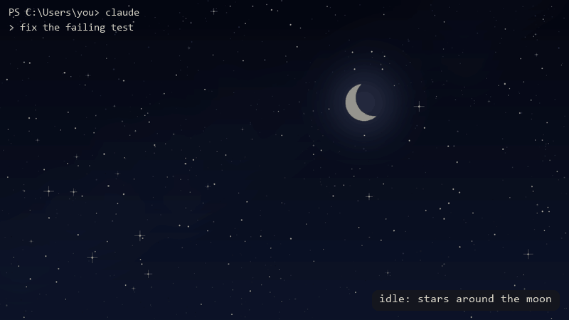
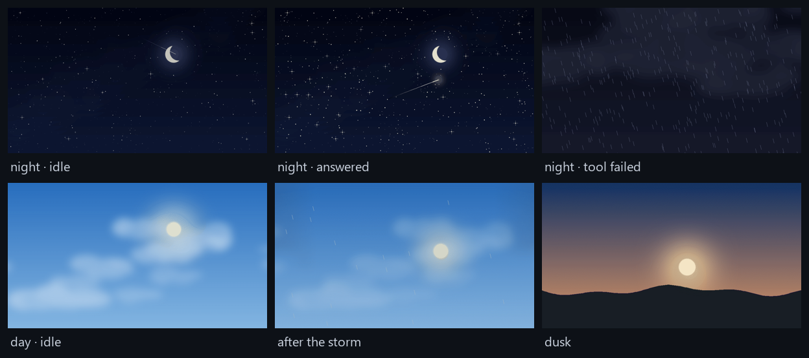

<div align="center">

# living-sky

**An animated sky behind Windows Terminal that reacts to Claude Code as it works.**

Stars around the moon at night, clouds drifting past the sun by day. A meteor shower
while Claude works, a thunderstorm when a tool fails (then the clouds part and the sky
comes back), a golden comet when it answers, and a real sunrise and sunset at the hours you pick.



<sub>One turn, rendered frame by frame with the terminal model in <code>tools/review.py</code> and the plugin's own timings
(<code>python tools/demo.py</code>); not a screen recording.</sub>

[Install](#install) · [Commands](#commands) · [How it works](#how-it-works) · [Make your own sky](#make-your-own-sky)

</div>

---

## Why

You glance away while Claude works. The sky tells you what it is doing without reading a line:

| When… | Night | Day |
|---|---|---|
| Claude is idle | stars twinkle around the moon, a slow shooting star | clouds drift past a warm sun |
| a turn is running | a **meteor shower** | the same clouds **race** |
| a tool fails, or the turn errors | **lightning and rain** | a grey sky, lightning, rain |
| …the storm passes | the clouds part, **the stars light up one by one** | the clouds part and **the sun climbs back** |
| Claude answers | a **golden comet** crosses and the stars flare | the **sun flares** and a flock of birds flies by |
| you interrupt it | no fanfare: calm sky | calm sky |
| the clock reaches your hours | **dusk**: the sun sets behind the hills | **dawn**: it rises again |

Day and night follow the clock: 07:00 and 19:00 by default, `/sky hours` to change them.



## Install

In Claude Code, running inside **Windows Terminal**:

```
/plugin install living-sky --marketplace anillaksu/living-sky
```

Answer `y` to add the marketplace and pick the **user** scope. (A project scope only loads in that one folder, and
the "Claude Code" tab starts Claude in your home folder, so its sky would never appear. Already installed per project?
`claude plugin install living-sky@living-sky --scope user`.) On the next session start living-sky adds a
**"Claude Code" profile** to Windows Terminal. Open it from the new-tab menu (the ⌄ next to +):
it starts Claude, and that tab is the one with the sky. Your other tabs keep their own look.

Requirements: Windows 10/11, [Windows Terminal](https://aka.ms/terminal) (Store, Preview or unpackaged), Claude Code with plugin support. Nothing else: no Python, no Node, no background service.

## Commands

| Command | What it does |
|---|---|
| `/sky` | show the current sky and the commands |
| `/sky auto` | day or night by the clock (default) |
| `/sky day` · `/sky night` | keep one sky |
| `/sky hours 7 19` | day starts at 7, night at 19 (any two hours; across midnight works) |
| `/sky off` | a plain background until `/sky auto` |
| `/sky profile` | add the "Claude Code" profile again (if you deleted it) |

Turkish works too: `/sky gece`, `/sky gunduz`, `/sky saat 7 15`, `/sky kapat`, `/sky profil`.

## How it works

- Windows Terminal reads `backgroundImage` from its `settings.json` and reloads the file as soon as it changes.
  It also plays **animated GIFs** there. living-sky ships twelve of them and points the setting at the one that fits the moment.
- Windows Terminal sets a background per **profile**, never per tab. So living-sky adds a profile of its own and paints
  **only that profile**, and only three keys of it: `backgroundImage`, `backgroundImageOpacity` and
  `backgroundImageStretchMode`. A Claude session in any other tab leaves that tab alone.
- Changes never jump. Scenes drawn to meet hand over directly: the storm runs into its clearing, and every clearing and
  every celebration ends on the exact first frame of the calm sky. Other changes within the same time of day dip softly;
  day and night meet through a full fade.
- It **edits the file in place**: your comments, your order and your formatting stay exactly as they were. It never
  re-serialises the JSON. There are tests for exactly this, including a byte-for-byte round trip.
- When the session ends the three keys are removed again: the profile goes back to a plain background.
- Outside Windows Terminal it does nothing at all.
- Opacity is tuned per scene so text stays readable: 0.75 for night, 0.32 for the bright day sky, 0.5 for dawn and
  dusk, and the storms in between (0.55 by night, 0.4 by day).

The scenes follow Claude Code's own events: `turn.start` → working, a failed tool (`PostToolUseFailure`) → storm,
`turn.complete` → sunrise, then calm.

## Built to look right

Windows Terminal crops the image to your window and blends it with your background colour, so a sky can look great in
one window and lose its moon in the next. `tools/review.py` renders every scene the way the terminal will, for five
window shapes (full screen, split pane, a wide short panel under an editor, ultrawide, laptop), with terminal text on
top, and measures:

- **legibility**: the WCAG contrast of your text against the brightest tenth of the window. All 24 scenarios pass:
  body text 5.8 to 11.6 (4.5 needed), dim secondary text 3.2 to 6.3 (3.0 needed). That is why the day is a soft sky
  and not a bright one.
- **composition**: the moon, the sun and the horizon stay inside the area every window shape keeps, and away from the
  top left, where your prompt is.
- **seams**: where scenes cut into each other the frames match to within 1.7/255.

```
python tools/review.py   # contact sheets in docs/review/, numbers in the console
```

## Make your own sky

Every scene is procedural and seeded, so it is reproducible and easy to tweak:

```
pip install pillow
python tools/generate.py              # all twelve scenes into assets/
python tools/generate.py night-busy   # just one
```

Change the colours, the number of stars, the meteor paths or the storm, regenerate, and restart Claude Code.
PRs with new scenes (aurora, snow, a city skyline…) are very welcome.

## FAQ

**I installed it and nothing happened?** Two usual reasons. The sky only shows in tabs of the "Claude Code" profile:
open one from the new-tab menu, not a plain PowerShell tab. And the plugin must be installed with the **user** scope
(see [Install](#install)); `claude plugin list` shows the scope.

**Will it mess up my Windows Terminal settings?** It adds one profile (once; delete it and it stays deleted) and
touches three keys of that profile alone, keeping every comment. Make a copy of `settings.json` first if you want to be
extra safe.

**Why a separate profile?** Windows Terminal has no per-tab background image, only per profile. Painting the profile
you happen to start Claude from would paint every tab of it.

**It only moves while I type?** Windows Terminal advances a GIF background when it repaints. In practice the sky keeps
moving most of the time, and always while Claude is working.

**macOS / Linux / WezTerm / iTerm2?** Not yet. WezTerm and kitty can do the same thing; contributions welcome.

**Several Claude sessions at once?** Tabs of the "Claude Code" profile share one sky; the most recent event wins.

## Roadmap

- [ ] **v0.2: real weather** — `/sky city <name>`, and the calm sky follows the weather outside (rain, snow, overcast,
      clear) through the free [Open-Meteo](https://open-meteo.com) API, no key needed
- [ ] sunrise and sunset by your location instead of fixed hours
- [ ] seasonal scenes (snow, autumn leaves, aurora)
- [ ] WezTerm support
- [ ] a scene per tool (a shovel for Bash, a book for Read?)

## Develop

```
claude plugin validate .
claude plugin test .
claude --plugin-dir .      # try it live
```

## License

MIT © [anillaksu](https://github.com/anillaksu)

<sub>Keywords: Claude Code plugin, Windows Terminal background, animated terminal background, GIF background,
ambient coding, terminal theme, day night cycle, developer experience, AI coding assistant status.</sub>
